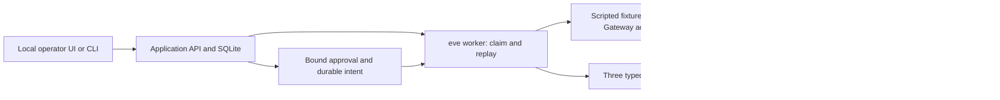

# Architecture and responsibility boundaries

One synthetic delivery-support workflow runs on one POSIX host. The model proposes a permitted action. Trusted application code requires exact human approval. An independently persisted receiver decides whether a write may commit.

## What each layer owns

| Layer                          | Responsibility                                                                       | Evidence boundary                                                             |
| ------------------------------ | ------------------------------------------------------------------------------------ | ----------------------------------------------------------------------------- |
| eve 0.80.1                     | Execution claims, durable checkpoints and replay                                     | Pinned runtime and guarded experimental lease; no distributed ownership claim |
| POSIX launcher                 | The actual worker holds the process lock                                             | Prevents a second local worker; does not fence another host                   |
| Application SQLite             | Immutable proposal, bound approval, accepted intent, attempts and persistent budgets | Transactions define approval/cancellation ordering                            |
| Three tools                    | Bounded typed inputs, read retries and authorized dispatch                           | No arbitrary network destination, shell or filesystem tool                    |
| Sandbox HTTP + separate SQLite | Authoritative context, expiry/epoch checks, idempotency transaction and receipt      | Independent effect counts verify named scenarios                              |
| Model adapter                  | Planning proposals through the same tool surface                                     | Fixture decisions are scripted; live transport remains unvalidated            |
| Evaluation                     | Barriers, process death/restart, negative controls and strict reports                | Controlled samples, not production reliability statistics                     |

Source entry points are [`agent/lib/lab/`](../agent/lib/lab/), [`sandbox/`](../sandbox/), [`lab/cli.mjs`](../lab/cli.mjs), [`test/`](../test/) and [`evaluation/`](../evaluation/). The [specification](SPECIFICATION.md) remains the implementation contract; milestone reviews record achieved observations separately.

## Approval and effect path

1. Read delivery and versioned policy using `get_delivery` and `get_resolution_policy`.
2. Persist an immutable proposal. Stop at `awaiting_approval`; no effect is authorized.
3. An operator approves its exact digest. Approval binds run, action, delivery revision, policy version and expiry.
4. A transaction validates approval and persists a stable dispatch intent/key. This is the approval/cancellation linearization point.
5. `record_resolution` sends the bound authorization to the sandbox. Its effect transaction checks authoritative context, expiry and worker epoch.
6. The receiver binds the key, action digest, effect and receipt atomically. An identical repeat returns the original receipt; a changed payload conflicts.
7. Recovery first reconciles a committed receipt. An absent receipt grants no new authorization. Existing results remain readable after expiry or budget exhaustion.

A cancellation after accepted intent cannot revoke a receiver transaction already accepted. The application keeps uncertainty explicit rather than presenting a timeout as proof of zero effects. Named successful/crash scenarios require one independent effect; denied cases require zero. These facts do not establish universal exactly-once execution for arbitrary external integrations.

## Runtime decision

The tested topology is Node 24, one host and one actual worker. The explicit twenty-second ownership lease is an experimental runtime setting, not a stable public eve API. Three exact installed-file hashes are guarded before experiments. With the framework's default 860-second lease, interrupted recovery misses the thirty-second target. The constrained setting passed the recovery and overlap probes; see [ADR 0002](adr/0002-single-worker-runtime-decision.md).

SQLite and the local worker lock are deliberate limits. Multi-host operation, horizontal scaling and production high availability require a new design and evidence. UTC-based accounting assumes a single host clock. Changing framework bytes or topology reopens runtime acceptance.

## Budgets and model boundary

Each run persists immutable limits: five model calls, eight physical tool executions, 8,000 requested output-token capacity, 16 KiB per tool input/output, ten-second physical tool deadline, 120 seconds active execution, fifteen-minute approval TTL, two reapprovals and a one-hour wall deadline. Approval waiting is excluded from active time. Retryable reads have at most three semantic attempts; a resumed physical execution still consumes its own unit.

The optional Gateway adapter reserves estimated cost before dispatch. Its default USD 0.10 run cap may be lowered. The dated price table and input-byte/framing heuristic are estimates, not an invoice or account-wide billing limit. Application provider retries/fallbacks are disabled. Unknown usage or an unresolved reservation blocks further calls in the affected run, including after restart. Abort stops local waiting but cannot establish that a provider stopped or did not bill. See [milestone 5](MILESTONE-5.md).

Fixture, offline Gateway simulation and genuine live evidence are distinct. Offline simulation uses the compiled worker and adapter with substituted transport; it makes no actual provider calls. Genuine provider connectivity, choices and billing remain `not_run`. Unknown actual usage and cost remain null.

## Evidence and operator boundary

The full fixture suite has 31 normal scenarios and two negative controls. Each control first passes against the baseline, then must fail with the intended invariant violation against a disposable mutation. Infrastructure errors do not satisfy this gate. Versioned reports include source/configuration/dependency hashes, denominators and measured effects. Strict Zod validation adds cross-field checks beyond the structural JSON Schema. Historical reports retain their original commits and measurements; current-source freshness is a separate check.

The operator is loopback-only, with exact Host/Origin checks, an expiring HttpOnly browser session and CSRF-safe mutations. It is local access control rather than enterprise identity. Core desktop flows have evidence; native reset-confirmation completion and mobile checks remain outstanding. The receiver contains synthetic support resolutions only: no real emails, refunds, payments or customer actions.
