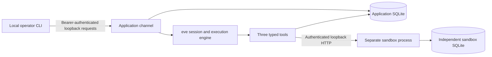

# Milestone 2: synthetic workflow and independent sandbox

Status: implementation present; eleven process cases and 24 unit/service tests pass locally; all four reviewers accept the scoped milestone and exact-code Linux CI passes. The repository remains private. This document describes implemented behavior and intended checks, not a completed release of the entire specification.

## Architecture and responsibility split



The fixture adapter chooses the next tool deterministically. It does not simulate database commits, HTTP transport or process recovery: these execute normally. It asserts that the exposed tool surface contains exactly `get_delivery`, `get_resolution_policy` and `record_resolution`. Default framework tools are disabled. The earlier probe tool is unavailable in fixture lab mode.

`get_delivery` reads the seeded synthetic delayed delivery. `get_resolution_policy` reads its permitted action and version. `record_resolution` proposes the fixed `request_update` action with the note “Please provide a delivery update.” and dispatches only after application approval. No email, refund, payment or real customer integration exists.

Eve 0.80.1 owns orchestration, execution claiming and checkpoint replay. The accepted experimental twenty-second ownership setting and exact runtime hash guards remain required. The application owns run/session authorization, immutable proposals, approval history, dispatch transactions and diagnostic events. The independent sandbox owns authoritative context, commit-time expiry, fencing and atomic effect idempotency.

Operator decisions use database revision CAS and the trusted local channel; worker transitions additionally require the current fencing epoch. The supported entry point is `npm run lab -- serve`. Its POSIX launcher holds the advisory lock in the actual worker process. After acquiring ownership, the worker activates a monotonically increasing sandbox epoch and records that generation in application state before starting the generated server. Old epochs cannot create new sandbox effects. Launching the worker entry or generated server directly bypasses the lock and is unsupported. This is a single-host, single-worker arrangement, not distributed HA.

## State and effect boundary

A run normally follows `queued → running → awaiting_approval → approved → executing → succeeded`.

A proposal binds the run, fixed action, delivery revision and policy version. Approval records the proposal digest, decision time and expiry. The dispatch-intent transaction consumes approval, persists a stable key and enters `executing`. Cancellation before intent produces `cancelled`; after intent it records `cancellationRequested` and does not claim rollback.

The sandbox checks an existing key first. Matching payloads return the committed receipt even after expiry or fencing changes. A changed payload conflicts permanently. For a new effect, the same SQLite transaction checks active epoch, authoritative delivery revision, policy version and authorization expiry, then commits the effect and receipt identity. The payload digest excludes epoch and expiry, so fresh approval of an unchanged intent preserves its key.

Commit-time expiry with confirmed no effect enters `awaiting_reapproval`; a fresh operator decision resumes the same action/key. Reapproval history is retained, with at most two reapprovals and a sixty-minute run deadline. The first accepted dispatch and each fresh reapproval dispatch consume one logical tool-call unit; retrying the already accepted intent consumes no additional unit. The happy path uses three units. The receiver expiry is capped at the run deadline, so accepted-intent retries cannot extend that deadline. Stale context and digest conflicts fail the run instead of silently changing its proposal.

An ambiguous HTTP outcome enters `unknown_outcome`. An explicit resume first performs read-only receipt reconciliation. A matching receipt permits success. A successful absent lookup permits only a retry of the existing accepted key and original authorization; it does not grant a fresh approval. The receiver still checks expiry and fencing at commit. An unreachable lookup or a receipt-binding mismatch remains visibly `unknown_outcome` without a new write. A confirmed expiry denial with zero effect allows cancellation from `awaiting_reapproval` to terminal `cancelled`; an unresolved accepted intent cannot be presented as safely cancelled.

## Key-free walkthrough

Requirements: Node.js 24, npm, macOS/Linux and `/usr/bin/python3` with `fcntl`. Run from the repository root. No provider account or key is needed.

```sh
npm ci --ignore-scripts
npm run typecheck
npm run format
npm test
npm run build
npm run lab -- init
npm run lab -- serve
```

Leave that terminal running. In another terminal:

```sh
npm run lab -- run
npm run lab -- list
npm run lab -- inspect RUN_ID
```

Replace `RUN_ID` with the returned identifier. Inspect until state is `awaiting_approval`. Read the action, versions and `proposal.digest`; approval requires that explicit inspected digest:

```sh
npm run lab -- approve RUN_ID PROPOSAL_DIGEST
npm run lab -- inspect RUN_ID
```

Inspect until `succeeded`, then examine the stable intent key, receipt and event timeline. For a separate run, demonstrate denial with `npm run lab -- reject RUN_ID`. Use `cancel RUN_ID` to request cancellation, or `resume RUN_ID` to reconcile an existing executing/unknown intent. Resume supplies no approval.

Initialization writes randomly generated operator and sandbox secrets to ignored `.local/lab/config.json`, with a private directory and file mode. Local application/sandbox databases, framework sessions and raw reports are ignored. The CLI passes only an explicit child-environment allowlist and does not inherit provider credentials. Never publish local configuration, raw sessions or secrets. Stopping and restarting `serve` reuses persisted state; `init` preserves an existing configuration and is not a destructive reset.

## Failure demonstration and evidence

```sh
npm run test:workflow
```

The harness uses isolated real processes, separate databases, an injected test clock and named barriers. Before-dispatch and after-sandbox-commit barriers allow the harness to kill the worker and restart against its persisted state. In the latter case, the sandbox stays alive and commits before holding its HTTP response. The harness queries its effects table independently and checks that recovery reuses the original key.

The harness writes `reports/workflow.json`, excluded from Git, with fixture labels, case observations and source hashes. All eleven process cases passed locally. The independent database contained zero effects for denied cases and one effect for each accepted/recovered case. Recovery measured 20,593 ms before dispatch and 20,548 ms after commit, below the 30-second watchdog. These are one observation per named case. See [source-bound local evidence](evidence/milestone-2-local.json). Linux CI also passed all eleven cases against the reviewed executable-source commit, with before-dispatch recovery of 20,102 ms and after-commit recovery of 21,053 ms. [Linux observations](evidence/milestone-2-ci.json) have matching source hashes; [the review](MILESTONE-2-REVIEW.md) records acceptance. Generated reports are preliminary engineering observations, not the final schema-validated evaluation export required by the specification.

The earlier compatibility experiments remain available through `npm run spike -- --lease-seconds=20`, `npm run spike:overlap -- --lease-seconds=20` and `npm run spike:ownership`. Running `npm run spike` without the override intentionally reproduces the known default-lease recovery limitation. See [ADR 0002](adr/0002-single-worker-runtime-decision.md), [initial investigation](adr/0001-runtime-durability-spike.md), [overlap review](OVERLAP-REVIEW.md) and [historical evidence](evidence/README.md).

## Remaining scope and limitations

- The local bearer/Host/Origin boundary is CLI access control, not enterprise authentication. The generic probe channel is unavailable without explicit spike configuration.
- Session authorization binds a trusted run ID and session ID. A missing binding can repair during authorized execution. A failed session creation can still leave an orphan queued application record; a durable cross-database handoff is not implemented.
- Complete read retry accounting, model-turn/active-time budgets, persisted attempt diagnostics, the full adverse-case matrix and negative-control tests remain later-stage work. Existing limits are not evidence that the entire budget specification is complete.
- The operator UI, optional live AI Gateway adapter, live usage/cost reporting and final exported-report schemas are not implemented. All current model decisions are labelled fixture; unavailable model usage is not reported as zero paid usage.
- The sandbox service credential is trusted: its holder can activate a new epoch and fence the current worker. Fencing is not protection against compromise of that credential. The guarded lock is shared with probe launchers intentionally so probes and lab workers cannot own the same runtime concurrently.
- Public-release documentation, full history/artifact review and explicit owner approval are still required. No visibility change or production deployment is part of this milestone.

The [implementation specification](SPECIFICATION.md) remains the full target contract. This milestone advances the fixture workflow and receiver boundary without claiming production reliability or universal exactly-once delivery.
